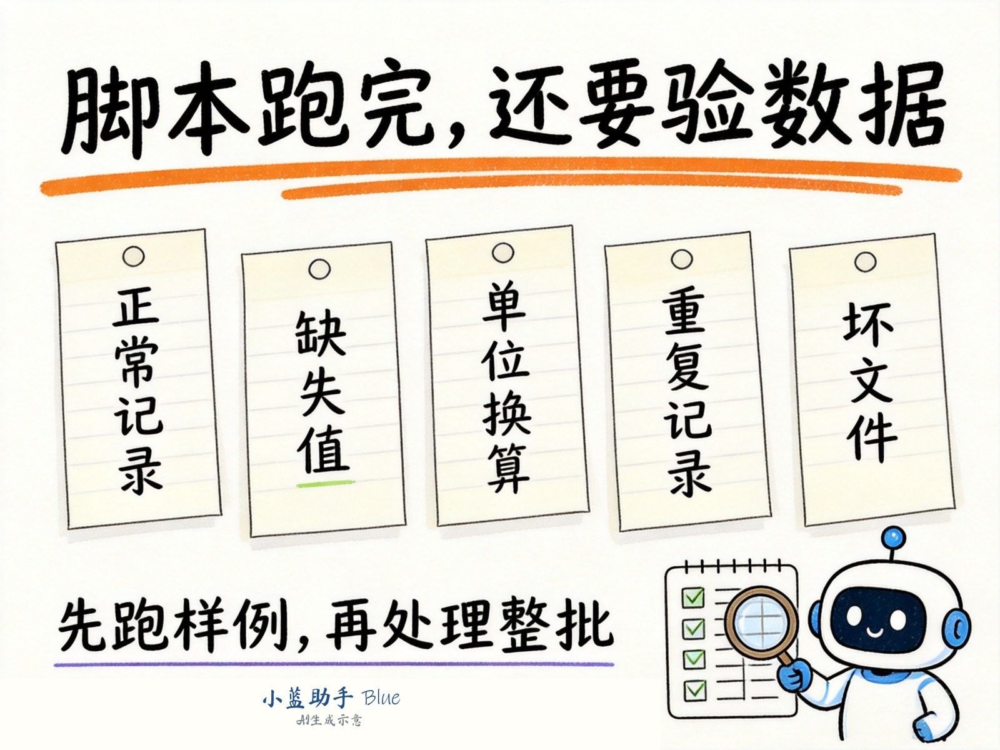

# CSV合并后少了几行，先别让AI再写一遍

脚本执行成功，合并文件也生成了，可结果比预期少了几行。直接把“重新写一个正确版本”发给AI，下一次可能只是换一种方式出错。

更有用的做法，是先缩小输入，找出哪类记录消失了。

下面用模拟记录介绍一套排查方法，适用于让小蓝助手或其他执行工具处理CSV的任务。示例不使用客户数据。

## 留下原始输入和第一版结果

先把本轮脚本、参数、日志和输出放到独立目录。下一次运行使用新目录，避免覆盖第一版结果。

同名文件不等于同一份输入。排查前记录实际读取的文件路径，必要时保存文件哈希。如果输入目录在排查过程中继续变化，两次结果就很难比较。

## 从一条正常记录开始加

先准备一份只有一条记录的CSV，确认列名映射与输出字段。

接着逐项加入以下变化：编号带前导零；某个数值为空；同一样本有两次测量；一条压力记录写成0.1MPa，而目标单位是kPa；另一个文件缺少必需列。

每加一类，就写下预期行为。编号“0012”仍是“0012”；空白仍表示缺失；同一样本的两次测量是否都保留，要由业务规则决定。0.1MPa换算为100kPa，但来源没有单位时不应自行猜测。

缺少列的文件可以终止本轮，也可以按约定隔离后继续。无论选哪种，都要在日志中出现文件名和原因。

## 给每条结果保留来源

在输出中增加来源文件和源记录序号，通常比只看最终总行数更容易找到问题。CSV字段中可能包含换行，因此记录序号不一定等于文本编辑器里的物理行号，说明中要区分清楚。

如果脚本进行了聚合，一条结果可能对应多条输入，就需要另外保留对应关系。不能硬给每一行结果只填一个来源，造成已经可以逐条追溯的假象。

## 把“少了几行”拆成明确的问题

先问文件是否全部读取，再问记录是否被过滤，最后看去重与聚合规则。空行、表头、解析失败和有效记录分别统计，不把文本文件的物理行数直接当作数据条数。

只有在“单纯拼接、没有过滤、没有去重、每条输入记录输出一条”的约定下，输出记录总数才应等于各文件有效记录数之和。做了分组汇总，这个等式就不适用了。

定位到差异后，让AI修改具体规则，并重跑刚才的小样本。确认样本通过，再处理完整输入。

## 把排查要求放进下一次任务

> 用小蓝助手 Blue（BlueDoAI）合并指定CSV。先核对字段、单位和记录含义，运行我提供的小样本并对比预期结果。保留原文件，结果写入新目录。输出来源关系、每个文件的处理状态和异常清单；未确定的去重规则先不执行。任何部分失败，都在交付说明中写清楚。

小蓝助手可以在授权范围内编写和运行脚本，继续处理Windows上的文件与应用任务。工具本体免费；使用BlueDoAI托管模型时另按实际用量计费。

遇到少行、错列或单位混用时，先留住一组能复现问题的小样本。它既能帮助修复当前脚本，也能在下次修改后检查问题有没有回来。

[小蓝助手产品介绍](https://www.bluedoai.com/legal/product-overview/) · [工业工艺与研发任务模板](https://github.com/ffawei/xiaolan-assistant-bluedoai/blob/main/examples/industrial-rd.md)

本文使用AI辅助整理与编辑，数据场景为模拟示例。
