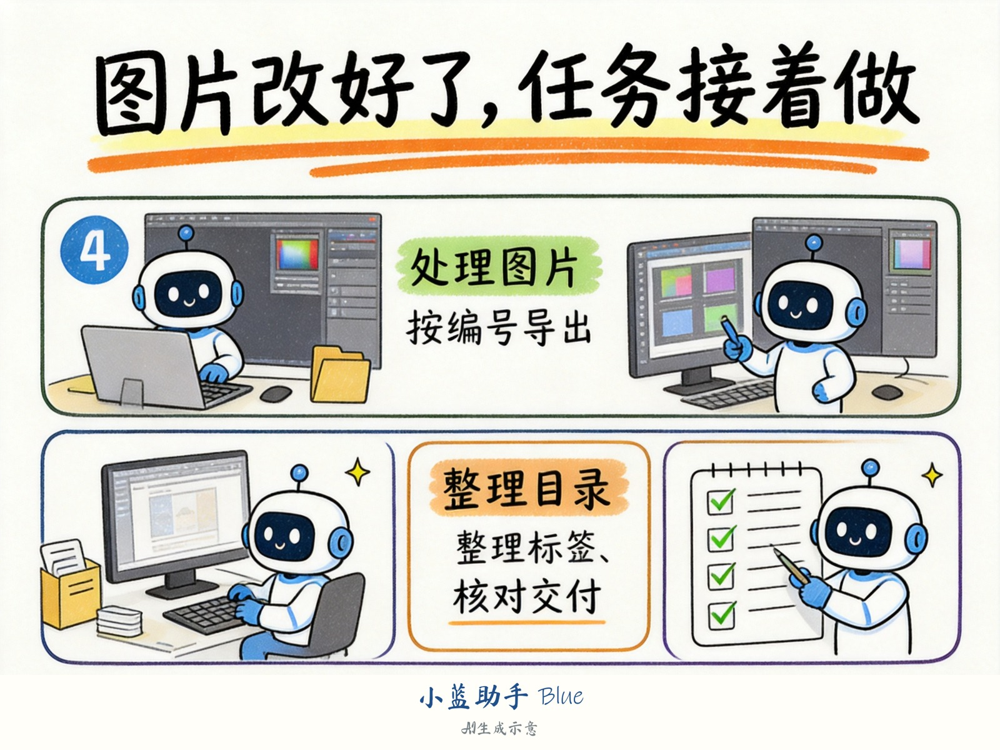

# 资料在安卓应用里，工作在Windows上：小蓝助手怎样接续MuMu任务

整理产品资料时，常会遇到这样一段工作：图片或文字在安卓应用里，表格和演示文稿在电脑上。资料取出来之后，还要命名、分类、补上来源，再放进交付目录。

这些步骤分散在不同环境中，单独做一段回答，通常替代不了实际操作。

小蓝助手 Blue（BlueDoAI）可以通过ADB连接MuMu模拟器，把支持的安卓应用操作接入Windows任务。真正安排工作时，先把下面几个衔接点说清楚，执行起来会更容易复核。

## 先确定要操作哪个实例

MuMu可以运行多个实例。ADB能连接，不代表连接的就是本次任务需要的那个。

应从当前MuMu版本的设置或官方说明中取得连接方式，确认目标实例和设备标识。不要直接套用网上某个固定端口，也不要让任务在多个设备之间凭顺序选择。

登录由用户完成。小蓝接续操作前，先确认当前应用、页面和账号是否正确，处理一条样本，再检查输出。

## 取得内容时，把来源一起留下

假设要整理自己有权使用的一组产品资料。每条资料至少留下标题、来源位置、取得时间和对应文件名。

应用支持导出或分享时，优先使用这些入口。如果某段文字只能通过截图识别，保留截图并标明需要复核；数字、型号和单位尤其要逐项检查。

这样做的目的很具体：过几天有人问“这张图是哪一款产品的”，可以顺着记录找到它，而不用再打开应用翻一遍。

下载与复制范围以账号权限、内容授权和平台规则为准。遇到验证码、权限不足或无法导出的内容，记录当前状态，交给用户处理。

## 从安卓接到Windows，要有对应表

资料落到电脑后，不急着全部改名。先建立一张对应表：原始标题或编号、原文件路径、拟用文件名、输出位置、处理状态。

例如，两条资料标题相同，图片却不同。如果只按标题命名，后一张可能覆盖前一张。把来源编号加入命名规则，或者先列为待确认项，就能避免这种问题。

截图、原图、经过PS处理的图也应分开存放。需要接续PS时，另行确认尺寸、格式、可编辑文件和导出要求，不把模拟器里的预览图当成已满足出版要求的原图。

## 给小蓝的任务可以这样写

> 使用我已登录的指定MuMu实例，整理我有权使用的产品资料。先处理3条：保存可导出的内容，记录来源和文件对应关系，再放入Windows的新目录。原文件保留，不覆盖。遇到登录验证、权限不足、重复命名或无法取得的资料，停下对应步骤并记录原因。样本确认后继续，最后交付文件、索引和未完成项。

这是一个任务模板，不是本次已经运行的演示记录。能执行哪些步骤，取决于MuMu版本、ADB连接、目标应用和当前权限。

## 验收看整条资料链

检查时抽一条资料，从应用来源找到电脑文件，再找到最终成果。标题、产品编号和图片应能对应；无法完成的项目要能在清单中找到原因。

小蓝的作用，是在用户授权范围内接续这些具体操作。复杂脚本、安卓应用与Windows文件可以属于同一项任务，最后交付仍应以可检查的文件为准。

工具本体免费，模型API由用户配置；使用BlueDoAI托管模型时按实际用量计费。本地算力接入取决于当前版本和接口适配情况。

[小蓝助手产品介绍](https://www.bluedoai.com/legal/product-overview/) · [跨应用任务模板](https://github.com/ffawei/xiaolan-assistant-bluedoai/blob/main/examples/cross-app-work.md)

本文使用AI辅助整理与编辑，资料整理场景为方法示例。
